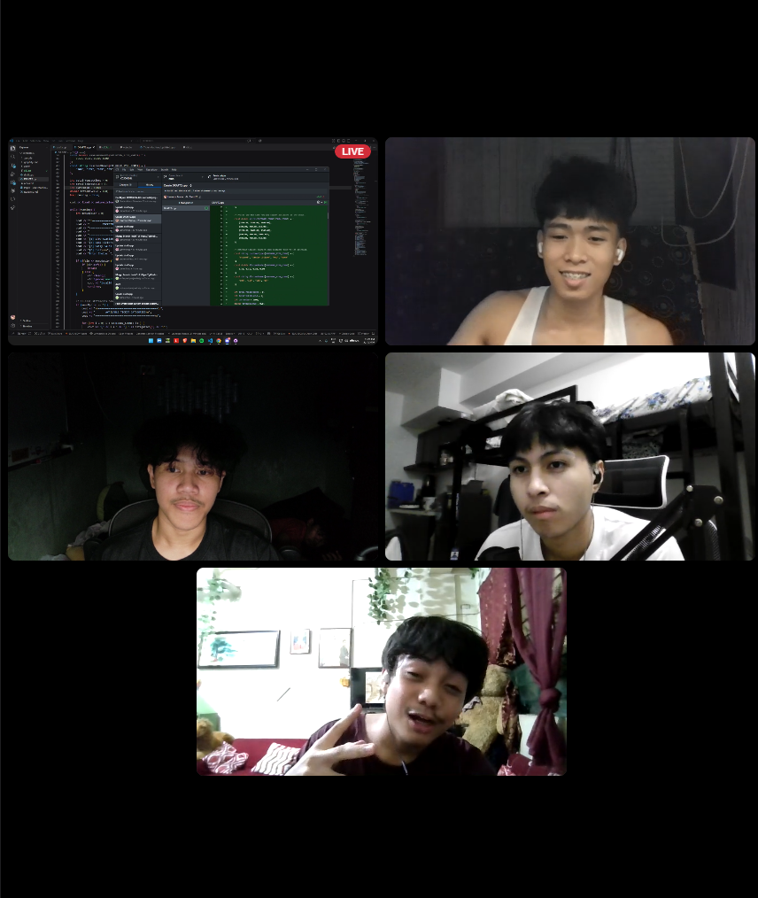
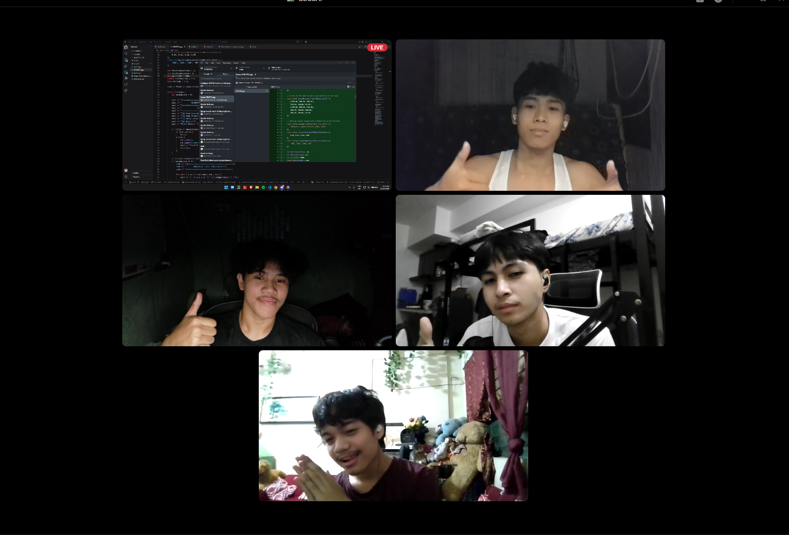
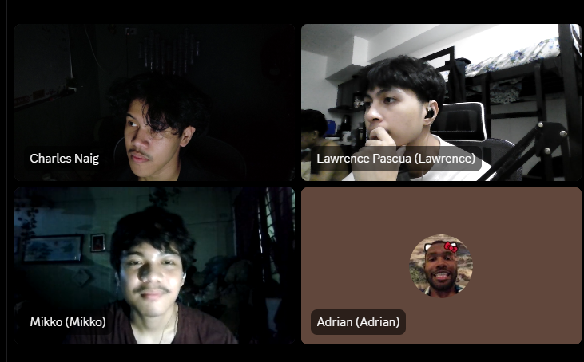

# TicketMachine Progress Report

**Course:** CCS00003L · **As of:** November 10, 2026

## Before coding

| Commit | What changed |
| --- | --- |
| [`6b069fd`](https://github.com/CharlesNaig/CCS00003L/commit/6b069fd) | Added the text mockup, planning notes, and initial README. The mockup laid out the kiosk menu, category and event selection, customer details, ticket computation, and sample receipt. It also proposed booking search and history. |

## During development

| Commit | What changed |
| --- | --- |
| [`317e7ea`](https://github.com/CharlesNaig/CCS00003L/commit/317e7ea), [`3c25b84`](https://github.com/CharlesNaig/CCS00003L/commit/3c25b84) | Began `draft.cpp` and added the first working kiosk, a VS Code build task, and a compiled executable. The program could list categories, book tickets, show receipts, and summarize sales. |
| [`afc6eb9`](https://github.com/CharlesNaig/CCS00003L/commit/afc6eb9) | Moved shared input and calculation variables to the top of `main()`. |
| [`65871ad`](https://github.com/CharlesNaig/CCS00003L/commit/65871ad), [`3bd7467`](https://github.com/CharlesNaig/CCS00003L/commit/3bd7467), [`a8ec4c2`](https://github.com/CharlesNaig/CCS00003L/commit/a8ec4c2), [`ca4940e`](https://github.com/CharlesNaig/CCS00003L/commit/ca4940e) | Revised the kiosk headings and receipt spacing in `draft.cpp`. |
| [`74ebd20`](https://github.com/CharlesNaig/CCS00003L/commit/74ebd20) | Added `DRAFT2.cpp`. It uses arrays for the catalog, prices, and discount rules, loops to display options, and checks numeric inputs before creating a booking. |

### Team collaboration

g
*Figure 1. The group on a video call with the TicketMachine code and Git changes on screen.*

*Figure 2. A wider view of the shared development screen and the group on the call.*

*Figure 3. The four group members in the project video call.*

## After the current development pass

- The prototype supports five ticket categories, event selection, discount calculations, sequential booking IDs, receipts, and session sales totals. Search and history remain proposed in the mockup.
- The working copy of DRAFT2.cpp now uses 0 to go back from the category, event, customer information, receipt, and sales report screens. The main menu still uses 0 to exit. Tested browsing, backing out before confirmation, and completing two bookings in one session.
- Styled the DRAFT2.cpp menus, receipt, and sales report with color-coded headings, choices, and status labels. Verified the palette in a Windows pseudoconsole and checked plain-text output for redirection.
- A run of `DRAFT2.cpp` confirmed that two PHP 300.00 tickets with a 10% student discount produce receipt `TM1000` for PHP 540.00. The report showed one transaction, two tickets, and PHP 540.00 revenue.
- The working copy of the [paper](Paper-TicketMachine.docx) now has the project narrative, pseudocode, and a booking flowchart. The [README](README.md) documents how to build the program and follow the source.

## Remaining before submission

- [ ] Confirm which C++ draft the group will submit and whether search and history are in scope.
- [ ] Run the final CLI and capture screenshots for the paper.
- [ ] Add the final commented source listing and defense date to the paper.
- [ ] Check that the paper, flowchart, and README match the submitted build.
